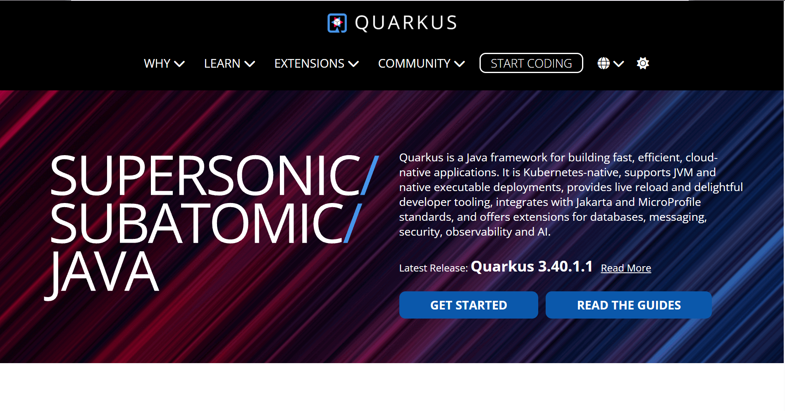
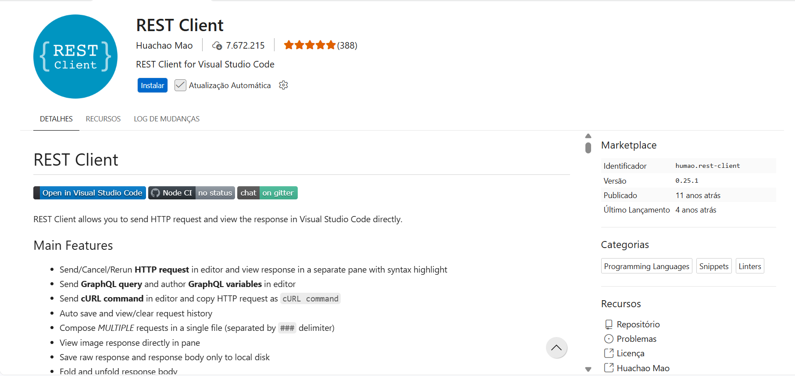
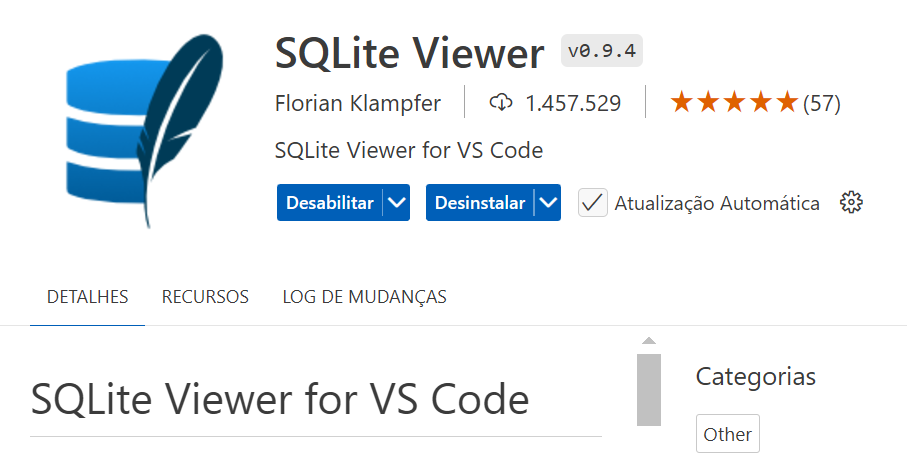

# java-api-crud-com-microframework-quarkus-sqlite-e-padrao-dao-com-code-quarkus-io

Este projeto foi estruturado para ensinar os fundamentos de APIs REST, usando a infraestrutura do microframework **Quarkus**, persistindo dados em um banco **SQLite** local e rodando no **GitHub Codespaces**.

--- 

## API CRUD com Quarkus, SQLite e Padrão DAO

Objetivo: demonstrar a construção de uma API REST, utilizando o ecossistema **Quarkus**.

Criar uma `API REST` com suporte a operações CRUD (CREATE, READ, UPDATE, DELETE), utilizando:

1. O microframework `Quarkus`, 

2. O banco de dados `SQLite`, 

3. Variáveis de ambiente lidas a partir de um arquivo `.env`, 

4. O padrão estrutural DAO (Data Access Object), 

5. A extensão para teste de APIs `REST Client`, 

6. O comando (Command Line Interface, CLI) para teste de APIs `curl` e

7. A extensão para visualização de dados no banco de dados `SQLite Viewer`.

---

## Arquitetura do projeto:

```text
├── .env
├── data/
|    └── usuario.db
├── pom.xml
├── README.md
├── Quarkus.png
├── RESTClient.png
├── SQLiteViewer.png
├── testes.http
└── src/
    └── main/
        ├── java/
        │   └── com/
        │       └── empresa/
        │           ├── model/
        │           │   └── Usuario.java
        │           ├── dao/
        │           │   └── UsuarioDAO.java
        │           └── resource/
        │               └── UsuarioResource.java (Controller)
        └── resources/
            └── application.properties
```
---

## Quarkus

https://quarkus.io/



---

## Gerando o Projeto no Code.Quarkus.io

1. Acesse o site [https://code.quarkus.io/](https://code.quarkus.io/).

2. No painel de metadados à direita, configure os seguintes campos:
   * **Group**: `com.empresa`
   * **Artifact**: `app`
   * **Build Tool**: `Maven`

3. No campo de busca por extensões, pesquise e selecione as duas opções abaixo:

   * `REST Jackson` (Para criar os controladores Web e processar JSON).
   ```text
   REST Jackson
   ```

   * `JDBC Driver - SQLite` (Para comunicação com o banco de dados).
   ```text
   JDBC Driver - SQLite
   ```
   
   * `Agroal` para JDBC Datasources and connection pooling:
   ```text
   Agroal - DB connection pool
   ```

4. No canto superior direito, clique no botão **Generate your application**.

5. No menu flutuante que abrir, selecione a opção **Push to GitHub** (isso vinculará sua conta e criará automaticamente um novo repositório para o projeto diretamente no seu perfil do GitHub).

---

## Executando o Projeto no GitHub Codespaces

1. Abra o repositório que foi gerado no seu GitHub.

2. Clique no botão verde **Code**, mude para a aba **Codespaces** e selecione **Create codespace on main**.

3. Inicie o servidor em modo de desenvolvimento com o comando abaixo:

   ```bash
   mvn quarkus:dev
   ```

   ou 

   ```bash
   mvn -Dquarkus.analytics.disabled=true quarkus:dev
   ```

   ou
   
   ```bash
   ./mvnw quarkus:dev -Dquarkus.test.continuous-testing=disabled
   ```

   **OBS**:
   *O servidor iniciará automaticamente na porta **8080**. A porta será configurada posteriormente no arquivo `application.properties`.* Entretanto, no ambiente do `Codespaces` do `GitHub`, será usada outra porta, como a `5005`. Então, no `VS Code` do `Codespaces` do `GitHub`:

   * Clique na aba `Portas` no painel inferior (painel do terminal).
   * Clique no botão `Adicionar Porta`.
   * Adicione a porta 8080. Mais a frente, será necessário adicionar a porta `8082` também. 
   * Caso seja necessário, altere a visibilidade das portas, tornando-as portas públicas. Para isso, clique como o botão direito do mouse sobre a coluna `visibilidade`.
   * Clique no ícone do `globo terrestre` de `Abrir no navegador`, ou copie a URL publicada e cole na barra de navegação do navegador.
   * Adicione /hello à URL. Exemplo:
   

   https://glowing-bassoon-97qp4q4479443p49q-8080.app.github.dev/q/dev-ui/welcome


   https://glowing-bassoon-97qp4q4479443p49q-8080.app.github.dev/hello


3. Assim que o terminal carregar, crie a pasta para o arquivo do banco de dados `SQLite` e configure o arquivo de ambiente `.env` executando:

   ```bash
   mkdir -p data
   ```

   ```bash
   echo "DB_PATH=./data/usuarios.db" > .env
   ```

   Conteúdo do arquivo `.env` na raiz do projeto:
   
   ```properties
   DB_PATH=./data/usuario.db
   ```

---

## Extensões Necessárias no VS Code do Codespaces
Instale as seguintes extensões no seu ambiente:

1. **REST Client** (para executar testes de API: arquivo de testes da API `testes.http`).



2. **SQLite Viewer** (para abrir e inspecionar visualmente as tabelas dentro do arquivo `.db` gerado).



---

# Arquivo de Configuração de Dependências (pom.xml)

O arquivo `pom.xml` gerencia as dependências do ecossistema `Quarkus` necessárias para expor endpoints `JSON` (`quarkus-rest-jackson`), fornecer o `pool` de conexões `JDBC` corporativo (`quarkus-agroal`) e conectar ao `SQLite` pela extensão `quarkus-jdbc-sqlite`, publicada pelo projeto Quarkiverse ([https://hub.quarkiverse.io/](https://hub.quarkiverse.io/)).

```xml
<?xml version="1.0" encoding="UTF-8"?>
<project xmlns="http://maven.apache.org/POM/4.0.0" xmlns:xsi="http://www.w3.org/2001/XMLSchema-instance" xsi:schemaLocation="http://maven.apache.org/POM/4.0.0 https://maven.apache.org/xsd/maven-4.0.0.xsd">
    <modelVersion>4.0.0</modelVersion>
    <groupId>com.empresa</groupId>
    <artifactId>app</artifactId>
    <version>1.0.0-SNAPSHOT</version>
    <packaging>quarkus</packaging>

    <properties>
        <compiler-plugin.version>3.15.0</compiler-plugin.version>
        <maven.compiler.release>25</maven.compiler.release>
        <project.build.sourceEncoding>UTF-8</project.build.sourceEncoding>
        <project.reporting.outputEncoding>UTF-8</project.reporting.outputEncoding>
        <quarkus.platform.artifact-id>quarkus-bom</quarkus.platform.artifact-id>
        <quarkus.platform.group-id>io.quarkus.platform</quarkus.platform.group-id>
        <quarkus.platform.version>3.40.1.1</quarkus.platform.version>
        <skipITs>true</skipITs>
        <surefire-plugin.version>3.5.6</surefire-plugin.version>
    </properties>

    <dependencyManagement>
        <dependencies>
            <dependency>
                <groupId>${quarkus.platform.group-id}</groupId>
                <artifactId>${quarkus.platform.artifact-id}</artifactId>
                <version>${quarkus.platform.version}</version>
                <type>pom</type>
                <scope>import</scope>
            </dependency>
        </dependencies>
    </dependencyManagement>

    <dependencies>
        <dependency>
            <groupId>io.quarkus</groupId>
            <artifactId>quarkus-rest-jackson</artifactId>
        </dependency>
        <dependency>
            <groupId>io.quarkiverse.jdbc</groupId>
            <artifactId>quarkus-jdbc-sqlite</artifactId>
            <version>3.0.11</version>
        </dependency>
        <dependency>
            <groupId>io.quarkus</groupId>
            <artifactId>quarkus-arc</artifactId>
        </dependency>
        <dependency>
            <groupId>io.quarkus</groupId>
            <artifactId>quarkus-rest</artifactId>
        </dependency>
        <dependency>
            <groupId>io.quarkus</groupId>
            <artifactId>quarkus-junit</artifactId>
            <scope>test</scope>
        </dependency>
        <dependency>
            <groupId>io.rest-assured</groupId>
            <artifactId>rest-assured</artifactId>
            <scope>test</scope>
        </dependency>
    </dependencies>

    <build>
        <plugins>
            <plugin>
                <groupId>${quarkus.platform.group-id}</groupId>
                <artifactId>quarkus-maven-plugin</artifactId>
                <version>${quarkus.platform.version}</version>
                <extensions>true</extensions>
            </plugin>
            <plugin>
                <artifactId>maven-compiler-plugin</artifactId>
                <version>${compiler-plugin.version}</version>
                <configuration>
                    <parameters>true</parameters>
                </configuration>
            </plugin>
            <plugin>
                <artifactId>maven-surefire-plugin</artifactId>
                <version>${surefire-plugin.version}</version>
                <configuration>
                    <argLine>@{argLine}</argLine>
                    <systemPropertyVariables>
                        <java.util.logging.manager>org.jboss.logmanager.LogManager</java.util.logging.manager>
                        <maven.home>${maven.home}</maven.home>
                    </systemPropertyVariables>
                </configuration>
            </plugin>
            <plugin>
                <artifactId>maven-failsafe-plugin</artifactId>
                <version>${surefire-plugin.version}</version>
                <executions>
                    <execution>
                        <goals>
                            <goal>integration-test</goal>
                            <goal>verify</goal>
                        </goals>
                    </execution>
                </executions>
                <configuration>
                    <argLine>@{argLine}</argLine>
                    <systemPropertyVariables>
                        <native.image.path>${project.build.directory}/${project.build.finalName}-runner</native.image.path>
                        <java.util.logging.manager>org.jboss.logmanager.LogManager</java.util.logging.manager>
                        <maven.home>${maven.home}</maven.home>
                    </systemPropertyVariables>
                </configuration>
            </plugin>
        </plugins>
    </build>

    <profiles>
        <profile>
            <id>native</id>
            <activation>
                <property>
                    <name>native</name>
                </property>
            </activation>
            <properties>
                <quarkus.package.jar.enabled>false</quarkus.package.jar.enabled>
                <skipITs>false</skipITs>
                <quarkus.native.enabled>true</quarkus.native.enabled>
            </properties>
        </profile>
    </profiles>
</project>
```

---

# Configurações Globais

 O arquivo `application.properties` fica Localizado em `src/main/resources/application.properties`.
 
 Este arquivo utiliza a especificação `MicroProfile Config` para gerenciar a aplicação. 

Ele altera a porta padrão e injeta dinamicamente a variável `${DB_PATH}` declarada no arquivo de ambiente `.env`.

```properties
# Altera a porta de execução padrão de 8080 para 8082:
quarkus.http.port=8082

# Configuração do banco de dados para utilizar o SQLite corporativo:
quarkus.datasource.db-kind=sqlite

# Injeta de forma dinâmica a variável de ambiente DB_PATH configurada no arquivo .env. Se não encontrar o arquivo ou se o arquivo não tiver a variável DB_PATH, criará o arquivo teste.db:
quarkus.datasource.jdbc.url=jdbc:sqlite:${DB_PATH:./data/teste.db}

# Configurações adicionais para otimização de pool de conexões do banco de dados:
quarkus.datasource.jdbc.max-size=5
quarkus.datasource.jdbc.min-size=1
```
**OBS**:
Neste ponto, será necessário reiniciar o servidor. A aplicação já estava em execução antes da alteração da porta. O processo precisa recarregar o application.properties. É sempre bom verificar se há outro processo usando a porta. Então, pare o servidor atual (`CTRL + c` no terminal) e reinicie:

   ```bash
   mvn quarkus:dev
   ```

   ou 

   ```bash
   mvn -Dquarkus.analytics.disabled=true quarkus:dev
   ```

   ou
   
   ```bash
   ./mvnw quarkus:dev -Dquarkus.test.continuous-testing=disabled
   ```

---

# Modelo de Domínio (Usuario.java)

O modelo `Usuario.java` representa a entidade de negócio como um Plain Old Java Object (POJO), contendo os campos exigidos para cada usuário em:

```text
src/main/java/com/empresa/model/Usuario.java
```

```java
package com.empresa.model;

import java.time.LocalDate;

public class Usuario {
    private Long id;
    private String nome;
    private LocalDate nascimento; // Data de nascimento do usuário.

    // Construtor padrão (obrigatório para o Jackson converter JSON em Objeto)
    public Usuario() {
    }

    public Usuario(Long id, String nome, LocalDate nascimento) {
        this.id = id;
        this.nome = nome;
        this.nascimento = nascimento;
    }

    // Getters e Setters
    public Long getId() {
        return id;
    }

    public void setId(Long id) {
        this.id = id;
    }

    public String getNome() {
        return nome;
    }

    public void setNome(String nome) {
        this.nome = nome;
    }

    public LocalDate getNascimento() {
        return nascimento;
    }

    public void setNascimento(LocalDate nascimento) {
        this.nascimento = nascimento;
    }
}
```

---

# Camada de Persistência (UsuarioDAO.java)

Camada de persistência em:

```text
src/main/java/com/empresa/dao/UsuarioDAO.java
```

Gerencia o ciclo de vida dos dados injetando a classe nativa do `pool` do `Agroal` (`AgroalDataSource`). 

Além das operações CRUD tradicionais, foi incluído um iniciador dinâmico (`createTable()`) com a anotação `@Startup` para criar a tabela de banco automaticamente caso ela não exista no banco de dados `SQLite` mapeado no arquivo de ambiente `.env`.

```java
package com.empresa.dao;

import com.empresa.model.Usuario;
import io.agroal.api.AgroalDataSource;
import io.quarkus.runtime.Startup;
import jakarta.enterprise.context.ApplicationScoped;
import jakarta.inject.Inject;
import java.sql.*;
import java.time.LocalDate;
import java.util.ArrayList;
import java.util.List;

@ApplicationScoped // Define que esta classe é um componente gerenciado de escopo único (Padrão Gof Singleton), Contexts and Dependency Injection (Contextos e Injeção de Dependências, CDI).
public class UsuarioDAO {

    @Inject
    AgroalDataSource dataSource; // Injeta o pool de conexões configurado no application.properties.

    @Startup // Executa este método automaticamente no momento em que a aplicação inicia.
    public void createTable() {
        String sql = """
                  CREATE TABLE IF NOT EXISTS usuarios (
                    id INTEGER PRIMARY KEY AUTOINCREMENT,
                    nome TEXT NOT NULL, 
                    nascimento TEXT NOT NULL);
                """; // SQLite armazena datas de forma otimizada como TEXT ISO-8601.
        try (Connection conn = dataSource.getConnection();
             Statement stmt = conn.createStatement()) {
            stmt.execute(sql);
        } catch (SQLException e) {
            throw new RuntimeException("Erro ao inicializar a tabela SQLite", e);
        }
    }

    public List<Usuario> buscarTodos() {
        List<Usuario> lista = new ArrayList<>();
        String sql = "SELECT id, nome, nascimento FROM usuarios";
        try (Connection conn = dataSource.getConnection();
             Statement stmt = conn.createStatement();
             ResultSet rs = stmt.executeQuery(sql)) {
            while (rs.next()) {
                lista.add(new Usuario(
                        rs.getLong("id"),
                        rs.getString("nome"),
                        LocalDate.parse(rs.getString("nascimento"))));
            }
        } catch (SQLException e) {
            throw new RuntimeException("Erro ao buscar usuários", e);
        }
        return lista;
    }

    public Usuario buscarPorId(Long id) {
        String sql = "SELECT id, nome, nascimento FROM usuarios WHERE id = ?";
        try (Connection conn = dataSource.getConnection();
             PreparedStatement pstmt = conn.prepareStatement(sql)) {
            pstmt.setLong(1, id);
            try (ResultSet rs = pstmt.executeQuery()) {
                if (rs.next()) {
                    return new Usuario(
                            rs.getLong("id"),
                            rs.getString("nome"),
                            LocalDate.parse(rs.getString("nascimento")));
                }
            }
        } catch (SQLException e) {
            throw new RuntimeException("Erro ao buscar usuário por ID", e);
        }
        return null;
    }

    public Usuario criar(Usuario usuario) {
        String sql = "INSERT INTO usuarios (nome, nascimento) VALUES (?, ?)";
        try (Connection conn = dataSource.getConnection();
             PreparedStatement pstmt = conn.prepareStatement(sql, Statement.RETURN_GENERATED_KEYS)) {
            pstmt.setString(1, usuario.getNome());
            pstmt.setString(2, usuario.getNascimento().toString()); // Converte LocalDate para String ISO (YYYY-MM-DD).
            pstmt.executeUpdate();

            try (ResultSet generatedKeys = pstmt.getGeneratedKeys()) {
                if (generatedKeys.next()) {
                    usuario.setId(generatedKeys.getLong(1)); // Define o ID autogerado pelo SQLite no objeto de retorno.
                }
            }
        } catch (SQLException e) {
            throw new RuntimeException("Erro ao inserir usuário", e);
        }
        return usuario;
    }

    public boolean atualizar(Usuario usuario) {
        String sql = "UPDATE usuarios SET nome = ?, nascimento = ? WHERE id = ?";
        try (Connection conn = dataSource.getConnection();
             PreparedStatement pstmt = conn.prepareStatement(sql)) {
            pstmt.setString(1, usuario.getNome());
            pstmt.setString(2, usuario.getNascimento().toString());
            pstmt.setLong(3, usuario.getId());
            return pstmt.executeUpdate() > 0;
        } catch (SQLException e) {
            throw new RuntimeException("Erro ao atualizar usuário", e);
        }
    }

    public boolean deletar(Long id) {
        String sql = "DELETE FROM usuarios WHERE id = ?";
        try (Connection conn = dataSource.getConnection();
             PreparedStatement pstmt = conn.prepareStatement(sql)) {
            pstmt.setLong(1, id);
            return pstmt.executeUpdate() > 0;
        } catch (SQLException e) {
            throw new RuntimeException("Erro ao deletar usuário", e);
        }
    }
}
```

# CDI

O acrônimo `CDI` no contexto de desenvolvimento Java significa `Contexts and Dependency Injection` (Contextos e Injeção de Dependências).

Ele é a especificação oficial do ecossistema `Jakarta EE` (antigo `Java EE`) e `MicroProfile` para gerenciar o ciclo de vida dos componentes e a fiação de dependências na aplicação.

Para quem está acostumado com o framework `Spring Boot`, o `CDI` desempenha exatamente o mesmo papel do `Spring IoC` (`Inversion of Control`). 

Ele resolve dois problemas centrais:

1. Injeção de Dependências (Dependency Injection)

Em vez de você instanciar manualmente as classes usando o operador `new` (o que acopla o código), o framework cria e gerencia os objetos para você.

• No Spring: você usa `@Autowired` ou injeção via método construtor.

• No CDI (Quarkus): você usa a anotação `@Inject` (que pertence ao padrão oficial do Java, `jakarta.inject.Inject`).

2. Gerenciamento de Contextos (Contexts / Scopes)

O `CDI` define por quanto tempo um objeto deve "viver" na memória do servidor. 

Os escopos mais comuns que substituem as anotações do Spring são:

• `@ApplicationScoped`: o componente tem uma única instância para toda a aplicação (equivalente ao `@Component` ou `@Service` padrão do Spring, que são o padrão de projeto `GoF` `Singleton`). É o que foi usado no `UsuarioDAO`.

• `@RequestScoped`: uma nova instância do componente é criada a cada requisição HTTP e destruída logo após a resposta ser enviada (equivalente ao `@Scope("request")` do Spring).

• `@SessionScoped`: a instância dura enquanto a sessão HTTP do usuário estiver ativa.

Em resumo: o `CDI` permite que anotações como `@Inject` e `@ApplicationScoped` funcionem no `Quarkus` sem que você precise carregar bibliotecas do Spring Boot.

---

# Camada de Controlador REST (UsuarioResource.java)

Controlador em:

```text
src/main/java/com/empresa/resource/UsuarioResource.java
```

Expõe os `endpoints` HTTP, utilizando a especificação `JAX-RS` com retornos estruturados via classe `Response`.

```java
package com.empresa.resource;

import com.empresa.dao.UsuarioDAO;
import com.empresa.model.Usuario;
import jakarta.inject.Inject;
import jakarta.ws.rs.*;
import jakarta.ws.rs.core.MediaType;
import jakarta.ws.rs.core.Response;
import java.util.List;

@Path("/usuarios") // Rota base da API.
@Produces(MediaType.APPLICATION_JSON) // As respostas do controlador serão estruturadas em JSON.
@Consumes(MediaType.APPLICATION_JSON) // As entradas recebidas devem obrigatoriamente ser JSON.
public class UsuarioResource {

    @Inject
    UsuarioDAO usuarioDAO; // Injeta a lógica de persistência de dados (DAO).

    @GET
    public List<Usuario> listar() {
        return usuarioDAO.buscarTodos();
    }

    @GET
    @Path("/{id}")
    public Response buscarPorId(@PathParam("id") Long id) {
        Usuario usuario = usuarioDAO.buscarPorId(id);
        if (usuario == null)
            return Response.status(Response.Status.NOT_FOUND).entity("{\"erro\": \"Usuário não encontrado\"}").build();

        return Response.ok(usuario).build();
    }

    @POST
    public Response criar(Usuario usuario) {
        if (usuario.getNome() == null || usuario.getNascimento() == null) 
            return Response.status(Response.Status.BAD_REQUEST).entity("{\"erro\": \"Campos 'nome' e 'nascimento' são obrigatórios.\"}").build();
        
        Usuario novoUsuario = usuarioDAO.criar(usuario);
        return Response.status(Response.Status.CREATED).entity(novoUsuario).build();
    }

    @PUT
    @Path("/{id}")
    public Response atualizar(@PathParam("id") Long id, Usuario usuario) {
        usuario.setId(id);
        boolean atualizado = usuarioDAO.atualizar(usuario);
        if (!atualizado) 
            return Response.status(Response.Status.NOT_FOUND).entity("{\"erro\": \"Usuário não encontrado para atualização\"}").build();
        
        return Response.ok(usuario).build();
    }

    @DELETE
    @Path("/{id}")
    public Response deletar(@PathParam("id") Long id) {
        boolean deletado = usuarioDAO.deletar(id);
        if (!deletado) 
            return Response.status(Response.Status.NOT_FOUND).entity("{\"erro\": \"Usuário não encontrado para remoção\"}").build();
        
        return Response.noContent().build(); // Retorna 204 No Content (padrão REST para deleção bem-sucedida).
    }
}
```
---

# Teste com a Extensão REST Client

1. Criar um arquivo chamado `testes.http` na raiz do projeto.

2. Colar o código abaixo.

3. Clicar no link `Send Request` que aparecerá automaticamente em cima de cada método HTTP.

```properties
### Configurações de Variáveis Locais do REST Client
@baseUrl = http://localhost:8082
@contentType = application/json

### 1. Criar Primeiro Usuário (Ana Silva)
# @name criarAna
POST {{baseUrl}}/usuarios
Content-Type: {{contentType}}

{
    "nome": "Ana Silva",
    "nascimento": "2000-05-15"
}

### 2. Criar Segundo Usuário (Carlos Souza)
POST {{baseUrl}}/usuarios
Content-Type: {{contentType}}

{
    "nome": "Carlos Souza",
    "nascimento": "1995-11-23"
}

### 3. Tentar Criar Usuário Inválido (Deve retornar Erro 400)
POST {{baseUrl}}/usuarios
Content-Type: {{contentType}}

{
    "nome": "Usuário Sem Data"
}

### 4. Listar Todos os Usuários
GET {{baseUrl}}/usuarios
Accept: {{contentType}}

### 5. Buscar Usuário por ID Específico
GET {{baseUrl}}/usuarios/1
Accept: {{contentType}}

### 6. Tentar Buscar Usuário Inexistente (Deve retornar Erro 404)
GET {{baseUrl}}/usuarios/999
Accept: {{contentType}}

### 7. Atualizar Dados do Usuário 1
PUT {{baseUrl}}/usuarios/1
Content-Type: {{contentType}}

{
    "nome": "Ana Silva Souza",
    "nascimento": "2000-05-15"
}

### 8. Deletar Usuário 2 (Deve retornar Status 204 No Content)
DELETE {{baseUrl}}/usuarios/2

### 9. Confirmar Deleção Listando Novamente
GET {{baseUrl}}/usuarios
Accept: {{contentType}}
```

4. Para verificar os dados salvos no banco de dados, clique com o botão direito sobre o arquivo criado em `data/usuarios.db` e selecione **Open with SQLite Viewer**.

---

## Teste com curl

Abra uma aba de terminal secundária no `GitHub Codespaces` para realizar chamadas REST de teste via utilitário `curl`:

Os exemplos abaixo usam os IDs `1` e `2` e pressupõem um banco novo. 

Ao repetir os testes, use os IDs retornados pelas requisições `POST` ou pare o servidor e remova `data/usuarios.db` para recriar o banco. A remoção apaga todos os registros desse banco.

### Cadastrar um Usuário (CREATE)
```bash
curl -X POST http://localhost:8082/usuarios \
  -H "Content-Type: application/json" \
  -d '{"nome": "Ana Silva", "nascimento": "2000-05-15"}'
```

### Listar Todos os Usuários (READ)
```bash
curl -X GET http://localhost:8082/usuarios
```

### Listar Usuário por ID (READ)
```bash
curl -X GET http://localhost:8082/usuarios/1
```

### Modificar Dados do Usuário (UPDATE)
```bash
curl -X PUT http://localhost:8082/usuarios/1 \
  -H "Content-Type: application/json" \
  -d '{"nome": "Ana Silva Souza", "nascimento": "2000-05-15"}'
```

### Remover Registro do Sistema (DELETE)
```bash
curl -X DELETE http://localhost:8082/usuarios/1
```

---

## Link

https://www.youtube.com/watch?v=vwsfBKJenvw

https://www.youtube.com/watch?v=6lHxh5EPEuU&t=1s


https://github.com/wdiasmaciel/quarkus-app-20261023-v1

https://github.com/wdiasmaciel/quarkus-app-20261023-v2

---

# Exercícios

Empregando a linguagem de programação Java, o microframework Quarkus, o banco de dados SQLite e Padrão DAO, implemente as seguintes APIs:

### 1) Cliente e Produtos
O sistema deve permitir:
1. O CRUD de clientes e de produtos.
2. Listar todos os produtos adquiridos por um certo cliente, cujo `id` é informado como parâmetro.
3. Listar as categorias de produto adquiridas por mais de `n` clientes, em que `n` é um número informado como parâmetro na API.

### 2) Agência de Viagens
O sistema deve permitir:
1. O CRUD de clientes e destinos turísticos.
2. Listar todos os destinos turísticos visitados por um certo cliente, cujo `id` é informado como parâmetro na API.
3. Listar todos os clientes que visitaram um certo destino turístico, cujo `id` é informado como parâmetro na API.
4. Listar os destinos turísticos agrupados e ordenados por país.
5. Listar todos os países com mais de `n` destinos turísticos, em que `n` é um número informado como parâmetro na API.

---

# app

This project uses Quarkus, the Supersonic Subatomic Java Framework.

If you want to learn more about Quarkus, please visit its website: <https://quarkus.io/>.

## Running the application in dev mode

You can run your application in dev mode that enables live coding using:

```shell script
./mvnw quarkus:dev
```

> **_NOTE:_**  Quarkus now ships with a Dev UI, which is available in dev mode only at <http://localhost:8080/q/dev/>.

## Packaging and running the application

The application can be packaged using:

```shell script
./mvnw package
```

It produces the `quarkus-run.jar` file in the `target/quarkus-app/` directory.
Be aware that it’s not an _über-jar_ as the dependencies are copied into the `target/quarkus-app/lib/` directory.

The application is now runnable using `java -jar target/quarkus-app/quarkus-run.jar`.

If you want to build an _über-jar_, execute the following command:

```shell script
./mvnw package -Dquarkus.package.jar.type=uber-jar
```

The application, packaged as an _über-jar_, is now runnable using `java -jar target/*-runner.jar`.

## Creating a native executable

You can create a native executable using:

```shell script
./mvnw package -Dnative
```

Or, if you don't have GraalVM installed, you can run the native executable build in a container using:

```shell script
./mvnw package -Dnative -Dquarkus.native.container-build=true
```

You can then execute your native executable with: `./target/app-1.0.0-SNAPSHOT-runner`

If you want to learn more about building native executables, please consult <https://quarkus.io/guides/maven-tooling>.

## Related Guides

- REST Jackson ([guide](https://quarkus.io/guides/rest#json-serialisation)): Jackson serialization support for Quarkus REST. This extension is not compatible with the quarkus-resteasy extension, or any of the extensions that depend on it
- Agroal - DB connection pool ([guide](https://quarkus.io/guides/datasource)): JDBC Datasources and connection pooling

## Provided Code

### REST

Easily start your REST Web Services

[Related guide section...](https://quarkus.io/guides/getting-started-reactive#reactive-jax-rs-resources)
